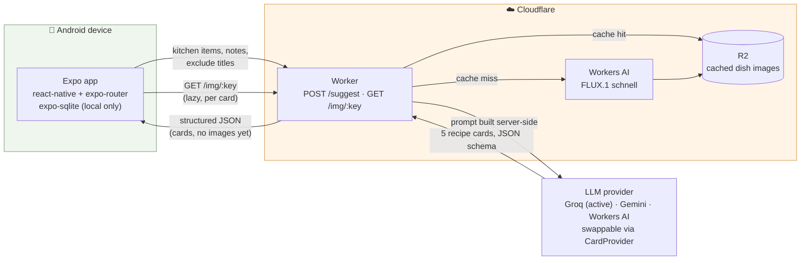

# mobile-recipes-ai

An Android app that suggests meal ideas from what's in the kitchen — Argentine
home cooking, rioplatense Spanish, voseo throughout. Browse suggestions
book-style through a card deck (back/next, not swipe-to-discard), save the
ones worth cooking, mark them off once you actually cook them.

Single user, single device, no accounts, no sync. Built for real use by its
author as a home cook in Buenos Aires. The full product spec — principles,
data model, API contract, prompt requirements, and every "we tried X and it
felt wrong" decision — lives in [`CLAUDE.md`](CLAUDE.md). Visual design
system is [`Design.md`](Design.md). This file is the map of the repo, not a
restatement of either.

## How it works

You tell the app what's in your kitchen (a chip grid grouped by location).
It asks an LLM for five recipe ideas that mostly use what you have, renders
them as a swipeable deck with a generated photo per dish, and lets you save
the ones you like. The API key that talks to the LLM never ships in the app —
a small stateless proxy holds it.



The app holds all state locally (kitchen items, saved recipes) and works
offline except when actually requesting suggestions. The Worker is
stateless — every request carries its own context, so nothing about your
kitchen is stored server-side.

## Repo layout

npm workspaces monorepo, all TypeScript.

```
apps/
  mobile/     Expo app (React Native + expo-router) — see apps/mobile/README.md
  worker/     Cloudflare Worker (wrangler) — see apps/worker/README.md
packages/
  shared/     Zod schemas + types shared by both — see packages/shared/README.md
plans/        Phase 1 build plan, milestones, scenario harness fixtures
```

**`packages/shared` is the reason this is a monorepo.** The recipe card shape
is defined once, as Zod schemas, and imported by both the app and the
Worker — the Worker derives the LLM's response schema from it and validates
against it; the app derives its render types from it. Change a field and
both sides fail to compile until they agree.

npm workspaces specifically, not pnpm — Metro (the RN bundler) has known
friction with pnpm's symlink layout.

## Getting started

```bash
npm install               # installs all three workspaces
```

Then, in separate terminals:

```bash
npm run dev -w apps/worker    # Cloudflare Worker, local (wrangler dev)
npm run start -w apps/mobile  # Expo dev server — scan the QR with Expo Go
```

The mobile app needs `apps/mobile/.env` pointed at the Worker's URL and
shared secret — see [`apps/mobile/README.md`](apps/mobile/README.md). The
Worker needs its own provider secret (e.g. `GROQ_KEY`) — see
[`apps/worker/README.md`](apps/worker/README.md).

Test on a real device via Expo Go, not just the simulator — the simulator
won't tell you whether the swipe gesture feels right.

## Status

Phase 1 (kitchen list → suggestion deck → detail → saved recipes → rate
limiting) is complete. See [`plans/README.md`](plans/README.md) for the
milestone table and what each step built and verified.

## Testing

Three tiers — see `CLAUDE.md` → Testing for the full rubric:

1. Manual prompt iteration, no app involved.
2. Scenario harness — fixed payloads run against the Worker, scored on
   feasibility, variety, Argentine authenticity, cookability, and image
   fidelity (`apps/worker/harness`).
3. Two weeks of real kitchen use — the only metric that matters is whether
   `La cociné` actually gets tapped.
