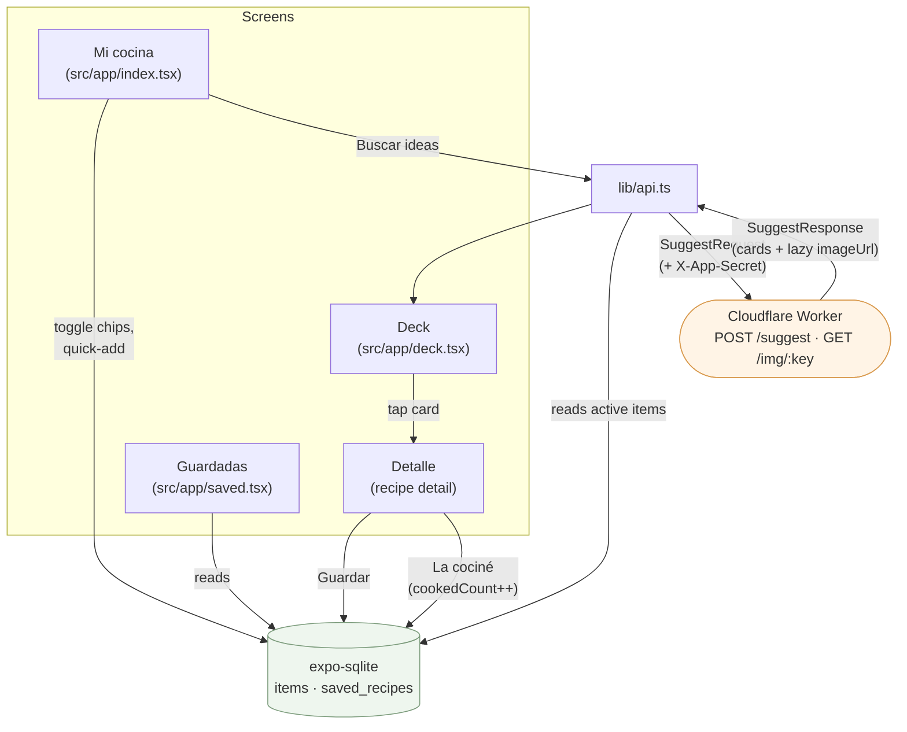

# apps/mobile

The Expo (React Native + expo-router) app. Android-first. Holds all state
locally and only touches the network to ask for suggestions and fetch dish
images. See the [root README](../../README.md) for how this fits with the
Worker and shared package, and [`CLAUDE.md`](../../CLAUDE.md) for the product
spec (screens, prompt requirements, decisions already made).

## Setup

```bash
npm install               # from repo root — this is an npm workspace
cp apps/mobile/.env.example apps/mobile/.env
```

Edit `.env`:

- `EXPO_PUBLIC_WORKER_URL` — the Worker's URL. On a real device over wifi,
  `wrangler dev` only binds to your laptop's own interfaces, so this must be
  your LAN IP (`http://192.168.1.x:8787`), not `localhost`. Simulator/web can
  leave it unset.
- `EXPO_PUBLIC_APP_SECRET` — must match the Worker's `APP_SECRET`, sent as
  `X-App-Secret` on every `/suggest` call. This deters casual scraping of a
  metered endpoint, not real auth (see `lib/api.ts`) — the app has no
  accounts by design.

```bash
npm run start -w apps/mobile
```

Scan the QR with **Expo Go** on a real Android device. Test on-device, not
just the simulator — the simulator won't tell you whether the swipe gesture
feels right.

## Structure

```
src/app/            expo-router screens (file-based routing)
  index.tsx           Mi cocina — bento grid of locations, chip toggles, quick-add
  deck.tsx            suggestion deck — swipeable cards, cuisine interstitial
  saved.tsx           Guardadas — saved recipes list
  _layout.tsx         fonts, theme, gesture-handler root

src/components/     screen-agnostic UI (Chip, Badge, BottomSheet, CalorieBadge, ...)
src/i18n/           react-i18next setup + es-AR resource bundle (all UI copy)
src/constants/      theme tokens (color, type scale, CalorieRange/CalorieRamp)
src/hooks/          use-color-scheme, use-theme, use-calendar-plan

db/                 expo-sqlite + Drizzle: schema.ts (items, saved_recipes), client.ts
lib/api.ts          talks to the Worker: builds SuggestRequest, retry/backoff,
                    reads items from SQLite
```

## Data flow



Everything under `Screens` and the SQLite store works fully offline. Only the
`Buscar ideas` action and each card's lazy image fetch touch the network.

## Other setup

- Lint: `npm run lint -w apps/mobile` (`expo lint`, config in `eslint.config.js`)
- Fresh starter template: `npm run reset-project -w apps/mobile` (moves the
  original Expo starter aside — not something you want on this repo's `src/app`)
