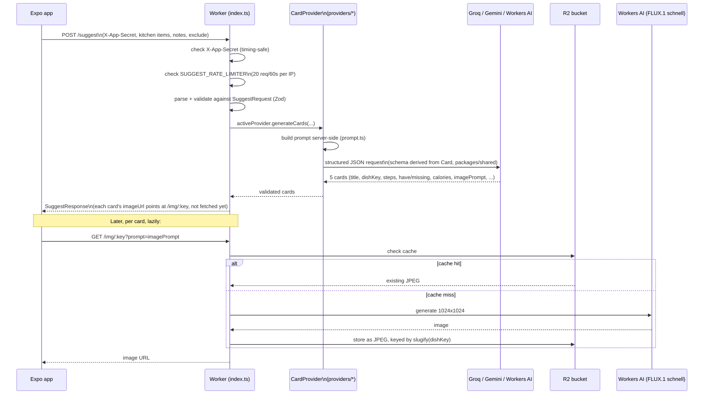

# apps/worker

Cloudflare Worker — the only thing that talks to the LLM provider and to
image generation. Stateless: every `/suggest` request carries its own
kitchen context, nothing is stored server-side. See the
[root README](../../README.md) for how this fits with the mobile app, and
[`CLAUDE.md`](../../CLAUDE.md) for architecture rationale, free-tier ceilings,
and the abuse-protection design.

## Why this exists

The active provider's API key must never ship in the APK. This Worker holds
it as a secret and is the only thing that calls it. It also builds the
prompt server-side — the client sends structured kitchen data only, so
nobody can point a modified client at the endpoint and use it as a free
general-purpose LLM proxy, and prompt iteration ships without a Play Store
release.

## Setup

```bash
npm install                 # from repo root
```

Create `apps/worker/.dev.vars` (local dev secrets, gitignored, no example
file committed):

```
GROQ_KEY=...       # active provider's key — see src/providers/index.ts
GEMINI_KEY=...      # only needed if you switch activeProvider to gemini
APP_SECRET=...      # must match the mobile app's EXPO_PUBLIC_APP_SECRET
SKIP_IMAGE_GEN=false # set to "true" to stop cache-miss FLUX calls from
                      # burning the shared daily image quota while iterating
                      # on anything other than image fidelity — see
                      # plans/adr/0001-dev-image-generation-toggle.md
```

Workers AI needs no secret — it's an account binding (`[ai]` in
`wrangler.toml`), not an API key.

```bash
npm run dev -w apps/worker      # wrangler dev, local
npm run harness -w apps/worker  # scenario harness against a running dev server
```

The recipe corpus (see "Recipe corpus fallback" below) needs a D1 database.
Locally, apply the schema once with
`npx wrangler d1 migrations apply potlucky-corpus --local` (from `apps/worker`);
`wrangler dev` then uses a local SQLite file and the placeholder
`database_id` in `wrangler.toml` is fine. For a deploy, create the real one
first: `npx wrangler d1 create potlucky-corpus`, paste the returned id into
`wrangler.toml`, then run the same command with `--remote`.

For deploying for real: `wrangler secret put GROQ_KEY` (and `APP_SECRET`),
then `npm run deploy -w apps/worker`. Production deploy is deliberately
deferred per the Phase 1 plan — see `plans/04-hardening.md`.

## Request flow



## Recipe corpus fallback

Every card a successful live `/suggest` generates is also written to a D1
table (`corpus_cards`, one row per `(dish_key, category)`, first version wins,
repeats bump `seen_count`) — no extra generation cost, via `ctx.waitUntil`.
That library is read **only** when Groq is genuinely down; normal-day batches
are always fresh.

- **When**: the provider fails with a 429 or any 5xx. A validation/parse
  failure (no status) stays a plain 502 for the client's own retry to handle.
  No Worker-side retry.
- **Never for** requests that set `cuisine` (the deck's country picks) — the
  corpus has no cuisine tag and would answer "Japón" with Argentine dishes.
  `category` is always matched, so baking and cooking never mix.
- **Matching** (`src/corpus.ts`): a stored card's non-staple ingredients are
  compared to the request's kitchen (normalized, whole-word, plural-tolerant).
  Score ≥ 0.5 qualifies; `have` is recomputed for the current kitchen and
  missing items stay flagged, never filtered out. `exclude` is a title match.
  Effort variety is a best-effort tiebreak, not a requirement.
- **Nothing qualifies** (empty or sparse corpus): the original 429/502 is
  returned, so the app's existing backoff still applies.
- The response carries `source: "live" | "corpus"` — for logs and the harness;
  the app doesn't read it.

`npm run corpus:check -w apps/worker` runs pure-logic checks on the matching.

## Structure

```
src/index.ts          fetch handler — routes, auth, rate limit, request/response validation
src/corpus.ts          D1 recipe corpus — save on live success, match + serve on Groq 429/5xx
migrations/            D1 schema (apply with `wrangler d1 migrations apply`)
src/prompt.ts          the system prompt (rioplatense Spanish, voseo, Argentine
                        ingredient vocabulary — see CLAUDE.md "Prompt requirements")
src/images.ts          R2 cache-or-generate for dish images, keyed by slugify(dishKey)
src/providers/
  types.ts              CardProvider interface + ProviderError
  base.ts               shared helpers across providers
  groq.ts                active provider — see comments for the structured-output caveat
  gemini.ts              Google Schema-proto dialect conversion from the Zod schema
  workers-ai.ts           free LLM option, also hosts image generation
  index.ts                the one-line switch: `activeProvider`
  schema.ts              builds each provider's JSON-schema dialect from the shared Card schema
harness/
  run.ts                scenario runner — scores fixed payloads against the rubric
  corpus-check.ts        pure-logic checks for the corpus matching (no network)
  scenarios/*.json       ~15 fixed kitchen payloads (six-cheese, near-empty, freezer-only, ...)
  output/                harness run results, for diffing across prompt edits
```

## Provider swap

The LLM call is behind `CardProvider`, not hardcoded. To switch providers,
change one line in `src/providers/index.ts` (`activeProvider = ...`) and set
the matching secret. Before switching, check the new provider's
tokens-per-minute ceiling specifically (not just request-count limits) and
whether it supports streaming with structured output — see `CLAUDE.md` →
"Decisions already made" for why the first-batch split into two calls exists
and exactly when to undo it.
