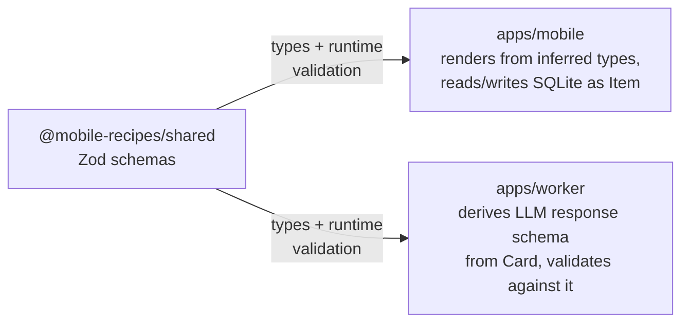

# packages/shared

`@mobile-recipes/shared` — the Zod schemas and types both other workspaces
import. This is the reason this repo is a monorepo: the recipe card shape is
defined once, and the app and Worker fail to compile if they drift apart.
See the [root README](../../README.md) for the full picture.

```
src/schema.ts    Location enum, Item — the kitchen data model
src/api.ts       SuggestRequest, Card, SuggestResponse, StoredCard —
                 the /suggest wire contract
src/seed.ts      30 seed kitchen items across the 5 locations
src/index.ts     re-exports all of the above
```



No build step — both consumers import the TypeScript source directly
(`main`/`types` in `package.json` point at `src/index.ts`). Changing a field
here means fixing both consumers, not a version bump and a republish.
